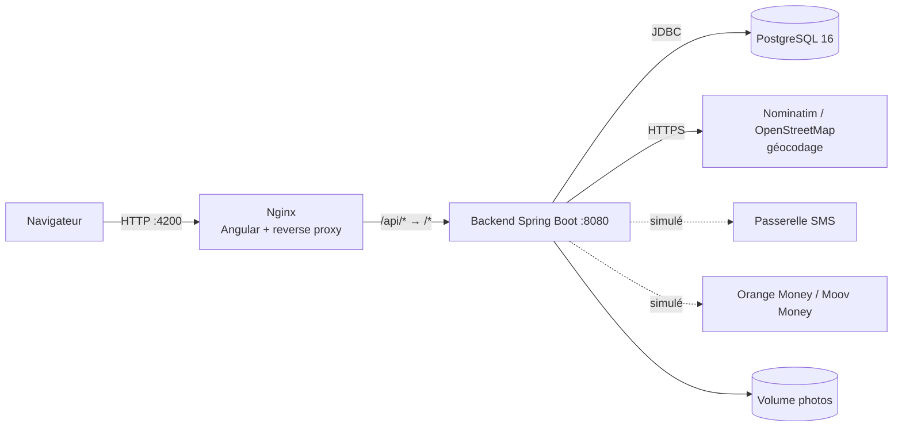

<div align="center">
  <h1>♻️ As'Soué</h1>
  <p><strong>Plateforme de gestion des déchets recyclables à Ouagadougou : les citoyens signalent des déchets géolocalisés et achètent des produits recyclés, les entreprises partenaires prennent en charge les collectes, As'Soué (ADMIN) supervise l'ensemble.</strong></p>

  [](https://angular.dev/)
  [](https://spring.io/projects/spring-boot)
  [](https://openjdk.org/)
  [](https://www.postgresql.org/)
  [](https://docs.docker.com/compose/)
</div>

---

## Sommaire

1. [À propos](#à-propos)
2. [Fonctionnalités par rôle](#fonctionnalités-par-rôle)
3. [Architecture](#architecture)
4. [Démarrage rapide (Docker)](#démarrage-rapide-docker)
5. [Développement sans Docker](#développement-sans-docker)
6. [Configuration (variables d'environnement)](#configuration-variables-denvironnement)
7. [Tests](#tests)
8. [Sécurité](#sécurité)
9. [État du projet et limites connues](#état-du-projet-et-limites-connues)
10. [Dépannage](#dépannage)
11. [Structure du dépôt](#structure-du-dépôt)
12. [Documentation détaillée](#documentation-détaillée)
13. [Auteurs](#auteurs)

---

## À propos

**As'Soué** est une application web complète (backend + frontend) développée en binôme. Elle relie trois acteurs :

- **Citoyens** : signalent des dépôts de déchets (photo + position GPS) et achètent des produits recyclés ;
- **Entreprises partenaires** : prennent en charge la collecte des déchets signalés ;
- **As'Soué (ADMIN)** : supervise les signalements, le catalogue, les commandes, les formations et les comptes entreprises.

Le backend est un **monolithe modulaire** Spring Boot, issu de la fusion de 6 microservices (auth, catalogue, commande, notification, paiement, signalement) ; voir l'historique et les raisons dans [`backend/README-backend.md`](./backend/README-backend.md).

## Fonctionnalités par rôle

| Rôle | Création du compte | Ce qu'il peut faire |
|---|---|---|
| **CITOYEN** | Libre (nom, téléphone, mot de passe + code OTP par SMS) | Consulter le catalogue et les formations, commander et payer (Orange Money / Moov Money), s'inscrire à une formation, signaler des déchets, suivre ses signalements et commandes |
| **ENTREPRISE** | Uniquement par un ADMIN | Voir le fil des signalements de ses types de déchets (triés par distance), en prendre un en charge, confirmer la collecte |
| **ADMIN** | Compte créé au premier démarrage | Gérer entreprises, produits, formations, signalements, commandes ; export CSV ; historique des SMS. **Connexion avec 2FA par SMS obligatoire** |

Les signalements de type `PNEU` sont rattachés automatiquement au compte « As'Soué » ; les autres types (`PLASTIQUE`, `AUTRE`) passent par un fil concurrentiel entre entreprises. Le détail pas à pas est dans [`backend/FONCTIONNEMENT.md`](./backend/FONCTIONNEMENT.md).

## Architecture



Le navigateur ne parle qu'à Nginx (une seule origine, donc pas de CORS) ; Nginx transmet `/api/...` au backend sur le réseau interne Docker.

**Stack** : Angular 22 (standalone components, signals, Tailwind CSS, Leaflet) · Spring Boot 3 / Java 17 · Spring Security (JWT stateless, BCrypt) · Spring Data JPA · PostgreSQL (H2 en dev/tests) · Swagger/OpenAPI · Docker Compose.

## Démarrage rapide (Docker)

Prérequis : Docker avec Compose v2. Pour le script de génération des secrets : Linux, macOS, WSL ou Git Bash (Windows), avec `openssl`.

```bash
git clone https://github.com/omaiodg-spec/A-Soue.git
cd A-Soue

./scripts/init-env.sh          # crée .env avec de vrais secrets aléatoires
docker compose up --build      # 1er démarrage : quelques minutes (build Maven + Angular)
```

> Sans le script : `cp .env.example .env`, puis remplacez **chaque** `CHANGE_MOI` (par exemple avec `openssl rand -base64 48`). Tant qu'un secret d'exemple subsiste, le backend **refuse de démarrer** (`APP_STRICT_SECRETS=true`) : c'est voulu, ces valeurs sont publiques.

| Service | URL | Remarque |
|---|---|---|
| Application | http://localhost:4200 | Via Nginx |
| API (Swagger UI) | http://localhost:8080/swagger-ui.html | Accessible depuis votre machine uniquement |
| PostgreSQL | `127.0.0.1:5432`, base `assoue_db` | Accessible depuis votre machine uniquement |

### Première connexion (ADMIN)

1. Sur http://localhost:4200, identifiant **`admin@cif.bf`** (saisi dans le champ « téléphone ») et le mot de passe `ADMIN_DEFAULT_PASSWORD` de votre `.env`.
2. L'envoi de SMS étant **simulé**, le code de vérification (2FA) s'affiche dans les logs du backend :
   ```bash
   docker compose logs -f assoue-backend | grep "SMS SIMULE"
   ```
3. Changez immédiatement le mot de passe dans **« Mon compte »**.
4. Créez ensuite le compte **As'Soué** (case « As'Soué elle-même ») depuis `/admin/entreprises`, sinon les signalements de pneus restent en attente.

## Développement sans Docker

**Backend** (Java 17, Maven) : base H2 en mémoire, aucune installation de base requise.
```bash
cd backend
mvn spring-boot:run          # API sur http://localhost:8080
```
En dev, les valeurs de repli (secrets d'exemple, mot de passe admin `admin123`) fonctionnent mais déclenchent des **avertissements** dans les logs : ne les utilisez jamais sur un serveur accessible depuis Internet.

**Frontend** (Node.js ≥ 22.22.3) :
```bash
cd frontend
npm ci
npm start                    # http://localhost:4200, /api/** redirigé vers localhost:8080
```

## Configuration (variables d'environnement)

Toutes se définissent dans `.env` (modèle : [`.env.example`](./.env.example)).

| Variable | Rôle | Obligatoire |
|---|---|---|
| `POSTGRES_USER` / `POSTGRES_PASSWORD` | Identifiants PostgreSQL | Oui (Docker) |
| `JWT_SECRET` | Signature des jetons (≥ 32 caractères) | Oui |
| `DATA_ENCRYPTION_KEY` | Chiffrement du nom/téléphone au repos. **La perdre = perdre les données.** À sauvegarder à part | Oui |
| `PAYMENT_WEBHOOK_SECRET` | Signature HMAC du webhook Orange/Moov Money | Oui |
| `ADMIN_DEFAULT_PASSWORD` | Mot de passe initial du compte admin (≥ 12 caractères) | Oui (Docker) |
| `APP_STRICT_SECRETS` | `true` : refuse de démarrer avec un secret d'exemple (défaut Docker) | Non |
| `SWAGGER_ENABLED` | `false` en production : masque Swagger et `/api-docs` | Non |
| `H2_CONSOLE_ENABLED` | Console H2 (dev uniquement, jamais en production) | Non |
| `CORS_ALLOWED_ORIGINS` | Origines autorisées pour les appels directs au backend | Non |
| `GEOCODING_USER_AGENT` | User-Agent envoyé à Nominatim, avec un contact valide (exigé par OSM) | Oui |
| `NOMINATIM_URL`, `SHOW_SQL` | Fournisseur de géocodage ; journalisation SQL (désactivée par défaut) | Non |

## Tests

```bash
cd backend && mvn test       # JUnit 5, Mockito, MockMvc, H2 en mémoire : ni Postgres ni Docker requis
```
Le frontend n'a pas encore de tests automatisés (voir « Limites connues »).

## Sécurité

Mécanismes en place : JWT stateless, mots de passe BCrypt, **2FA SMS obligatoire pour les ADMIN**, nom et téléphone chiffrés au repos (AES-256-GCM) avec recherche par HMAC, webhook de paiement signé (HMAC-SHA256, comparaison en temps constant), prix et disponibilité **toujours recalculés côté serveur**, limitation de débit Nginx sur `/api/auth/`, en-têtes de sécurité HTTP, garde-fou des secrets au démarrage.

- Signaler une vulnérabilité : voir [`SECURITY.md`](./SECURITY.md).
- Avant toute mise en production : suivre [`docs/PRODUCTION-CHECKLIST.md`](./docs/PRODUCTION-CHECKLIST.md). Le projet **n'est pas prêt pour la production** tant que les SMS et le paiement sont simulés (voir ci-dessous).

## État du projet et limites connues

| Sujet | État |
|---|---|
| Géocodage OpenStreetMap (Nominatim) | Réel. Limité à 1 requête/s sur l'instance publique |
| Stockage des photos | Réel, sur disque (volume Docker), compressées à 800 px max, formats JPEG/PNG |
| **SMS (OTP, notifications)** | **Simulé** : le contenu, donc le code OTP, apparaît dans les logs |
| **Orange Money / Moov Money** | **Simulé** : la confirmation passe par le webhook signé, à brancher sur les vraies clés |
| Fil entreprise : « mes prises en charge » | Pas de route dédiée : le suivi est gardé dans le `localStorage` du navigateur (non partagé entre appareils) |
| Listes admin | Non paginées |
| Tests frontend | Aucun pour l'instant |
| Framework | Spring Boot 3.3.4 est **hors support** (fin du support open source de la branche 3.3 en 2025) : mise à jour à planifier |

## Dépannage

| Symptôme | Cause / solution |
|---|---|
| `docker compose` : « `XXX manquant : lancez ./scripts/init-env.sh` » | `.env` absent ou incomplet : lancez `./scripts/init-env.sh` |
| Le backend s'arrête : « Secrets non conformes » | Un secret vaut encore `CHANGE_MOI` ou `admin123` : remplacez-le dans `.env` |
| Erreur 429 sur la connexion | Limite de débit Nginx sur `/api/auth/` (30 req/min par IP) : patientez une minute |
| Je ne reçois pas de SMS | Normal : envoi simulé, lisez le code dans les logs (voir plus haut) |
| Photo refusée | Seuls JPEG et PNG, 10 Mo et 40 mégapixels maximum |
| Les noms/téléphones sont illisibles après un changement de clé | `DATA_ENCRYPTION_KEY` a changé : restaurez l'ancienne clé |

## Structure du dépôt

```
A-Soue/
├── docker-compose.yml        # Postgres + backend + frontend (Nginx)
├── .env.example              # Modèle de configuration (ne contient aucun vrai secret)
├── scripts/init-env.sh       # Génère .env avec des secrets aléatoires
├── SECURITY.md
├── docs/PRODUCTION-CHECKLIST.md
├── backend/                  # API Spring Boot (FONCTIONNEMENT.md, README-backend.md)
└── frontend/                 # Application Angular (nginx.conf, README-frontend.md)
```

## Documentation détaillée

- [Règles métier pas à pas](./backend/FONCTIONNEMENT.md)
- [Rapport technique du backend (architecture, routes, déploiement)](./backend/README-backend.md)
- [Frontend (pages, services, fonctionnement du proxy)](./frontend/README-frontend.md)
- [Checklist de mise en production](./docs/PRODUCTION-CHECKLIST.md)

## Auteurs

Projet imaginé et développé en binôme par :

- **Oumaimata Ouedraogo** : développement frontend
- **Amiir Savadogo** : développement backend

<div align="center"><i>Si ce projet vous plaît, laissez une ⭐ !</i></div>
